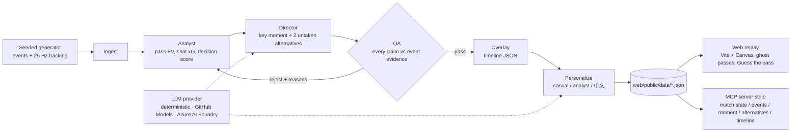

# Other Pitch

**Counterfactual football replay.** Other Pitch finds the key decision in a match. It replays that moment on an animated 2D pitch and shows ghost versions of the passes the player did not make, each labeled with a probability. Before the reveal, viewers play *Guess the pass*.

> All teams, players, and matches are fictional and generated from a seed (Harbour City FC vs Northvale Athletic). This project uses no real Premier League clubs, logos, players, or data.

Built for the Microsoft × Premier League **Inside the Game** hackathon.

## Architecture



The agents are executors in a **Microsoft Agent Framework** workflow (`otherpitch/workflow.py`, `agents.py`). Each handoff is a typed envelope with `evidence_ids`. The run is written to `trace.json`. In the seeded run, QA rejects the Director's first draft once (an unsupported number) and accepts the second attempt.

## Sponsor tech

| Tech | Use |
|---|---|
| Microsoft Agent Framework (`agent-framework`) | Workflow graph for the 6 agents, with a QA reject loop and a retry budget |
| Model Context Protocol (`mcp` FastMCP) | `python -m otherpitch.mcp_server --data web/public/data` exposes `get_match_state`, `list_events`, `get_moment`, `get_alternatives`, `get_timeline` |
| GitHub Models (free, no card) | `OTHERPITCH_LLM=github GITHUB_TOKEN=...` rewrites captions; QA still checks every number |
| Azure AI Foundry | `OTHERPITCH_LLM=foundry` plus `AZURE_AI_FOUNDRY_ENDPOINT`, `AZURE_AI_FOUNDRY_API_KEY`, `AZURE_AI_FOUNDRY_MODEL` (optional `AZURE_AI_FOUNDRY_API_VERSION`) (OpenAI-compatible chat endpoint). Documented only; this project does not need a paid account, and no card is bound |
| Deterministic fallback | Default. No network. Any LLM error falls back to the templates |

## Run

```bash
python -m venv .venv && . .venv/bin/activate
pip install -r requirements.txt
python -m pytest -q                                   # tests
python -m otherpitch.build --seed 7 --out web/public/data/ [--no-llm]
python -m otherpitch.mcp_server --data web/public/data # MCP over stdio
cd web && npm install && npm run dev                  # replay at localhost:5173
```

Deploy: `vercel` from the repo root (see `vercel.json`).

## Credits

Inspired by the NBA *Inside the Game* broadcast work and *Broadcast Code 12*. All of this project's code and data are original.

## License

See `LICENSE`.
